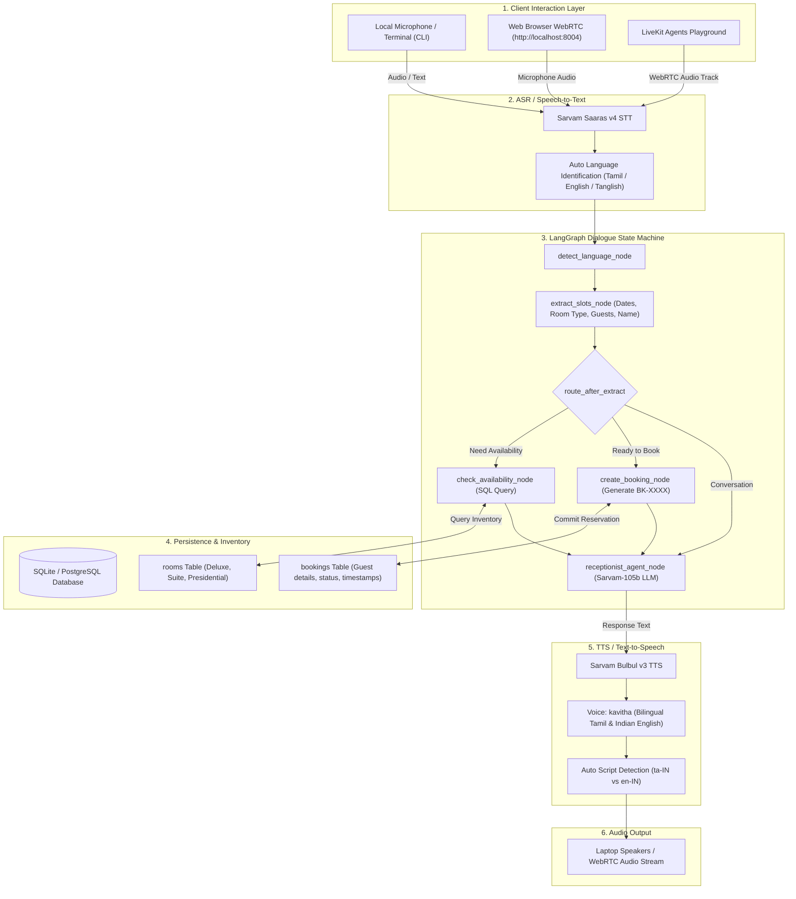

# Sunrise International Hotel - AI Voice Assistant (Maya)
## System Architecture & Local Execution Guide

---

## 1. Executive Summary

**Maya** is a production-grade, bilingual (Tamil, English, Tanglish) AI Voice Receptionist designed for **Sunrise International Hotel**.

Maya handles guest room inquiries, checks room availability in real-time against a transactional database, collects guest booking details, confirms reservations with unique confirmation codes, and responds with natural human-like speech.

### Core Philosophy: Decoupled Local AI
Telephony carriers (e.g. Exotel, PSTN, SIP trunks) introduce external friction such as firewall port restrictions, carrier bridge delays, and duplicate leg dialing. To ensure **predictable, zero-interruption, low-latency local testing**, the system architecture strictly decouples the **Core AI Brain** from external telephony.

The entire AI pipeline (**ASR + LLM + DB + TTS**) runs seamlessly on your local laptop.

---

## 2. High-Level Architecture Diagram



---

## 3. Core Component Breakdown

### A. Speech-to-Text (ASR): Sarvam Saaras v4
* **Model**: `saaras:v4`
* **Features**:
  * Real-time WebSocket streaming and REST fallback.
  * Native understanding of Indian accents, colloquial Tamil, English, and mixed Tanglish (e.g. *"enakku deluxe room venum"*).
  * Auto-detects language codes (`ta-IN`, `en-IN`).

### B. Dialogue State Machine: LangGraph
The conversational brain is implemented as a deterministic 5-node state graph:

| Node Name | Responsibility |
|---|---|
| `detect_language_node` | Identifies Tamil (`ta-IN`), English (`en-IN`), or Tanglish from user input. |
| `extract_slots_node` | Extracts entities: `room_type`, `check_in`, `check_out`, `num_guests`, `guest_name`, `guest_phone`. |
| `check_availability_node` | Queries the database for room inventory and pricing for given dates. |
| `create_booking_node` | Atomically commits confirmed booking and generates confirmation code (`BK-XXXXXX`). |
| `receptionist_agent_node` | Sarvam 105b conversational LLM generates natural bilingual receptionist replies. |

#### State Schema (`BookingState`):
```python
class BookingState(TypedDict):
    messages: List[BaseMessage]
    language: Optional[str]            # 'ta-IN', 'en-IN', 'tanglish'
    guest_name: Optional[str]
    guest_phone: Optional[str]
    room_type: Optional[str]           # 'deluxe', 'executive', 'presidential'
    check_in: Optional[str]            # YYYY-MM-DD
    check_out: Optional[str]           # YYYY-MM-DD
    num_guests: Optional[int]
    is_available: bool
    available_room_id: Optional[int]
    price_per_night: Optional[float]
    total_price: Optional[float]
    guest_confirmed: bool
    booking_confirmed: bool
    confirmation_code: Optional[str]   # e.g. BK-782190
    stage: str                         # 'greeting', 'collecting_slots', 'confirmed'
```

### C. Database Layer: SQLAlchemy
* **Default Database**: SQLite (`hotel_booking.db`) for lightweight local testing.
* **Production**: PostgreSQL with `pgvector` for semantic room searches.
* **Pre-seeded Inventory**:
  * **Deluxe Room**: ₹3,500/night (King bed, city view, high-speed Wi-Fi)
  * **Executive Suite**: ₹6,500/night (Living area, balcony, bathtub, lounge access)
  * **Presidential Suite**: ₹12,000/night (Panoramic ocean view, private jacuzzi, butler)

### D. Text-to-Speech (TTS): Sarvam Bulbul v3
* **Model**: `bulbul:v3`
* **Speaker**: `kavitha`
* **Features**:
  * Seamless code-switching between Tamil and Indian English.
  * Low latency PCM / WAV output at 24kHz.
  * Automatic language selection based on script detection.

---

## 4. How to Test Locally (Zero Telephony Overhead)

### Mode 1: Interactive Terminal Runner (Fastest & Direct)
Run the local interactive runner to chat directly with Maya from your terminal. Maya will speak through your laptop speakers:

```powershell
python -m agent.local_runner
```

* **Sample Interaction**:
  ```text
  👤 You: வணக்கம்! எனக்கு ஒரு டீலக்ஸ் ரூம் வேணும்
  🤖 Maya: Welcome to Sunrise International Hotel! We have Deluxe rooms available. 
            For how many nights would you like to stay?
  
  👤 You: Check in tomorrow for 2 nights, 2 guests. My name is Karthik.
  🤖 Maya: Your Deluxe room is available at ₹3,500 per night (Total: ₹7,000). 
            Shall I confirm this reservation for you?
  
  👤 You: Yes please, confirm.
  🤖 Maya: Wonderful! Your booking is confirmed. Your confirmation code is BK-948123. 
            We look forward to welcoming you to Sunrise International Hotel!
  ```

---

### Mode 2: Automated AI Verification
Run an end-to-end automated test across all 4 pipeline stages (ASR -> LangGraph -> DB -> TTS):

```powershell
python -m agent.local_runner --verify
```

---

### Mode 3: Local Web Browser Client (Microphone & Speaker)
1. **Start the FastAPI Backend**:
   ```powershell
   python -m uvicorn api.main:app --host 0.0.0.0 --port 8004 --reload
   ```
2. **Start the LiveKit Voice Agent**:
   ```powershell
   python -m agent.worker dev
   ```
3. Open your browser to:
   ```text
   http://localhost:8004
   ```
4. Click **"Connect"** and speak into your laptop microphone!

---

## 5. File & Directory Reference

| File Path | Description |
|---|---|
| `agent/local_runner.py` | Standalone local CLI runner with speech synthesis and interactive chat. |
| `agent/worker.py` | LiveKit WebRTC Voice Agent worker bridging VAD, STT, LangGraph, and TTS. |
| `agent/sarvam_stt.py` | Sarvam Saaras v4 STT implementation with WebSocket and REST fallback. |
| `agent/sarvam_tts.py` | Sarvam Bulbul v3 TTS plugin with auto script detection and `kavitha` voice. |
| `agent/lang_detector.py` | Fast regex and Unicode script detector for Tamil, English, and Tanglish. |
| `graph/graph.py` | LangGraph StateGraph builder wiring the 5 dialogue nodes. |
| `graph/nodes.py` | Node logic for slot extraction, DB queries, and booking creation. |
| `graph/state.py` | TypedDict schema for hotel reservation state. |
| `api/main.py` | FastAPI application exposing room endpoints, booking CRUD, and WebRTC tokens. |
| `frontend/` | Browser voice client with live audio waveform and slot visualizations. |

---

## 6. Summary of Architectural Advantages

1. **Deterministic State Machine**: LangGraph guarantees that reservations are never created without room availability and explicit guest confirmation.
2. **Zero Telephony Lag**: Bypassing external telecom carriers enables testing at sub-second conversational latency.
3. **Bilingual Fluency**: Unified Tamil and English understanding without requiring manual language switching.
4. **Idempotent Operations**: All booking actions and voice greetings are guarded against duplicate executions.
