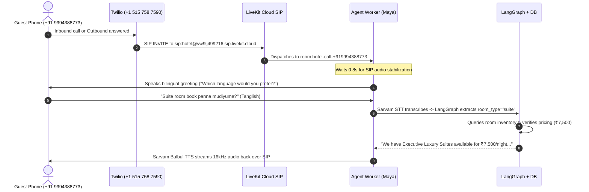

# 🏗️ System Architecture & Dataflow
> Related: [[Index]] • [[Voice_Pipeline]] • [[Dialogue_State_Machine]] • [[Telephony_Integration]]

This document outlines the end-to-end architecture of **Sunrise International Hotel's AI Voice System**, covering how cellular telephone calls, WebRTC audio streams, and backend state machines interact in real-time.

---

## 1. High-Level Architecture Diagram

```mermaid
flowchart TD
    subgraph Telecom["1. Cellular Telephony (PSTN)"]
        Caller["Guest Mobile (+91 9994388773)"]
        Twilio["Twilio Telephony (+1 515 758 7590)"]
    end

    subgraph WebClient["2. Web Client Interface"]
        Browser["Guest Browser (Web Audio / Mic)"]
        UI["FastAPI Dashboard (Port 8004)"]
    end

    subgraph MediaBridge["3. LiveKit Cloud Infrastructure"]
        SIPTrunk["Inbound SIP Trunk (ST_FqcE6X4R76nP)"]
        SIPRule["Dispatch Rule (hotel-individual-rule)"]
        SFU["LiveKit Cloud SFU (ai-hotel-5hl7n2nq)"]
        Room["LiveKit Room (hotel-call-{caller})"]
    end

    subgraph VoiceAgent["4. AI Agent Core (Maya)"]
        Worker["Agent Worker (worker.py)"]
        VAD["Silero VAD (Speech Boundaries)"]
        STT["Sarvam Saaras v4 STT (Auto Language)"]
        TTS["Sarvam Bulbul v3 TTS (16kHz HD Audio)"]
    end

    subgraph LogicLayer["5. Dialogue & Inventory"]
        LangGraph["LangGraph State Machine"]
        DB[("Database: SQLite / PostgreSQL")]
    end

    Caller <-->|GSM / Cellular Call| Twilio
    Twilio <-->|TwiML / Webhook| UI
    Twilio <-->|SIP Audio (G.711 / Opus)| SIPTrunk
    SIPTrunk --> SIPRule --> SFU
    Browser <-->|WebRTC Media| SFU
    SFU <--> Room <--> Worker

    Worker --> VAD --> STT
    STT -->|Transcript| LangGraph
    LangGraph <-->|Query & Book| DB
    LangGraph -->|Response Text| TTS
    TTS -->|16kHz PCM Stream| Worker
```

---

## 2. Architectural Layers

### Layer 1: Telephony Ingress & Egress (Twilio + LiveKit SIP)
- **Twilio**: Acts as the carrier interface for the hotel's purchased phone number (**`+1 515 758 7590`**).
- **LiveKit Cloud SIP Bridge**: Connects cellular phone lines directly into WebRTC rooms via `sip:hotel@vw9lj499216.sip.livekit.cloud`.
- See detailed documentation in **[[Telephony_Integration]]**.

### Layer 2: Real-Time Media Engine (LiveKit Cloud)
- **Project Name**: `AI_hotel` (`p_vw9lj499216`)
- **Server**: `wss://ai-hotel-5hl7n2nq.livekit.cloud`
- Provides Selective Forwarding Unit (SFU) audio distribution, handling low-latency jitter buffering, WebRTC packet pacing, and audio track subscriptions.

### Layer 3: Voice Perception & Generation
- **Silero VAD**: Low-latency ONNX voice activity detection for instant speech onset detection and endpointing.
- **Sarvam Saaras v4 STT**: Specialized acoustic model for Indian English, colloquial Tamil, and code-mixed Tanglish.
- **Sarvam Bulbul v3 TTS**: High-fidelity Indian voice synthesis (`kavitha`) running at **16,000 Hz** for HD telephony clarity.
- See detailed documentation in **[[Voice_Pipeline]]**.

### Layer 4: Conversational Brain (LangGraph)
- A cyclic, deterministic directed graph orchestrating dialogue turns.
- Automatically handles slot collection (`room_type`, `check_in`, `check_out`, `num_guests`, `guest_name`, `guest_phone`), inventory validation, pricing computation, and reservation confirmation.
- See detailed documentation in **[[Dialogue_State_Machine]]**.

### Layer 5: Data Persistence
- **SQLAlchemy 2.0 ORM** backing two primary models:
  1. `Room`: Room categories (Deluxe, Suite, Standard), base pricing, capacity, and amenities.
  2. `Booking`: Reservation records, confirmation codes (`BK-XXXXXX`), check-in/out dates, guest phone number, and total billing.

---

## 3. End-to-End Call Sequence



---

> [!success] Architectural Decoupling Benefit
> The system completely decouples telephony transport from the AI brain. The exact same LangGraph intelligence and Sarvam models power **both** cellular phone calls (via Twilio SIP) and browser web audio (via FastAPI Port 8004).
