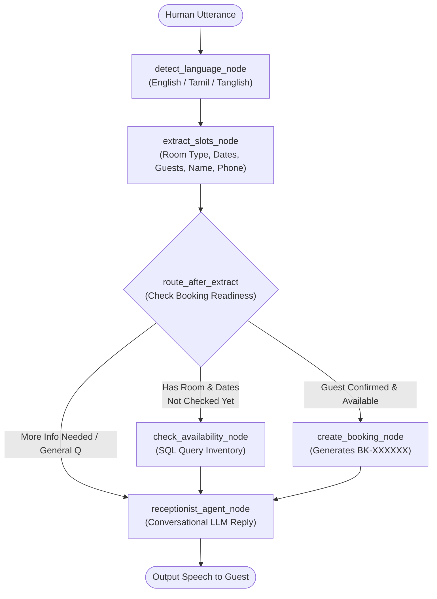

# 🧠 Dialogue State Machine (LangGraph)
> Related: [[Index]] • [[Architecture]] • [[Voice_Pipeline]] • [[Operations_And_Execution]]

This document details the deterministic, multi-turn conversational engine powering **Maya**, implemented via **LangGraph**.

---

## 1. Graph Topology & State Flow



---

## 2. State Schema (`BookingState`)

The state schema is defined in [`graph/state.py`](file:///C:/Users/shahiil/Desktop/AI_hotel/graph/state.py):

```python
class BookingState(TypedDict):
    messages: Annotated[list[BaseMessage], add_messages]
    language: Optional[str]              # 'en-IN', 'ta-IN', or 'tanglish'
    guest_name: Optional[str]            # e.g. "Shakil"
    guest_phone: Optional[str]           # e.g. "+919994388773"
    guest_email: Optional[str]
    room_type: Optional[str]             # 'deluxe', 'suite', 'standard', 'budget'
    check_in: Optional[str]              # e.g. "2025-12-25"
    check_out: Optional[str]             # e.g. "2025-12-26"
    num_guests: Optional[int]            # e.g. 4
    is_available: bool                   # True when database confirms inventory
    available_room_id: Optional[int]
    available_room_name: Optional[str]
    price_per_night: Optional[float]     # e.g. 7500.0
    total_price: Optional[float]         # e.g. 9500.0 (includes taxes)
    guest_confirmed: bool                # True when guest explicitly says "confirm" / "சரி"
    booking_confirmed: bool              # True when committed to database
    confirmation_code: Optional[str]     # e.g. "BK-A8F31D"
    stage: str                           # 'greeting', 'collecting', 'quoted', 'confirmed'
```

---

## 3. Node Specifications

### 1. `detect_language_node`
- Identifies whether the guest preferred English, Tamil, or Tanglish.
- Preserves preferred language across dialogue turns unless the guest explicitly switches.

### 2. `extract_slots_node`
- Deterministically parses speech transcripts for key booking entities in both English and Tamil:
  - **Room Categories**: `suite` / `சூட்`, `deluxe` / `டீலக்ஸ்`, `standard` / `ஸ்டாண்டர்ட்`.
  - **Guest Count**: *"4 family members"* -> `num_guests = 4`; *"நாலு பேர்"* -> `num_guests = 4`.
  - **Dates**: Relative (*"tomorrow"*, *"today"*, *"நாளைக்கு"*) and explicit (*"December 25th"*).
  - **Confirmation Words**: *"confirm"*, *"yes"*, *"proceed"*, *"aama"*, *"seri"*, *"சரி"*, *"ஆம்"*.

### 3. `check_availability_node`
- Queries the transactional `rooms` inventory table.
- Verifies that `room.max_occupancy >= num_guests`.
- Calculates total stay cost based on nights and room pricing.

### 4. `create_booking_node`
- **Safety Guard**: NEVER triggers unless `guest_confirmed == True` AND `is_available == True`.
- Generates a cryptographically unique 6-character booking code (format: `BK-XXXXXX`).
- Inserts record into `bookings` table with timestamps and guest details.

### 5. `receptionist_agent_node`
- Synthesizes the natural verbal response in the guest's chosen language.
- Prompt rules enforce concise, 1-2 sentence spoken answers tailored for phone interactions.
- Clarifies payment policies directly (*"Payment can be completed at the front desk upon arrival or via our secure link"*).

---

## 4. Multi-Turn Dialogue Example (Bilingual)

> [!example] Real-World Conversation Trace
> **Maya**: *"Welcome to Sunrise International Hotel! I am Maya, your virtual receptionist. Which language would you prefer — English, Tamil, or Tanglish? வணக்கம், நீங்கள் எந்த மொழியில் பேச விரும்புகிறீர்கள்?"*  
> **Guest**: *"Tanglish-la pesalam. 4 family members varom, suite room irukka?"*  
> **Maya**: *"Sure! Engalukku Executive Luxury Suite available-aa irukku. Check-in date eppo nu solla mudiyuma?"*  
> **Guest**: *"December 25th check-in, 26th morning check-out."*  
> **Maya**: *"Got it! One night stay from 25th to 26th December total ₹9,500 aagum. Reservation confirm panna unga name and mobile number solluveengala?"*  
> **Guest**: *"Name Shakil, number 9994388773. Confirm pannidunga."*  
> **Maya**: *"Thank you Mr. Shakil! Unga booking confirm aaiduchu. Confirmation code BK-7E29A1. Looking forward to welcoming you to Sunrise Hotel!"*
