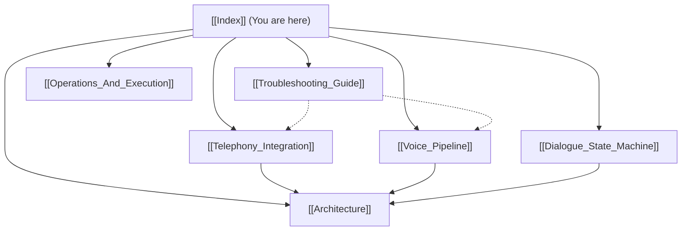

# 🏨 Sunrise International Hotel — AI Voice Receptionist (Maya)
> **Autonomous, Real-Time Bilingual Telephony & Web Voice Receptionist**
> Powered by **Twilio**, **LiveKit Cloud SIP**, **Sarvam AI (Saaras v4 & Bulbul v3)**, and **LangGraph**.

---

## 🧭 Map of Content (Vault Navigation)



| Document | Primary Focus | Key Technologies |
| :--- | :--- | :--- |
| **[[Architecture]]** | System architecture, component layers, dataflow | LiveKit Cloud, FastAPI, SQLite/Postgres |
| **[[Voice_Pipeline]]** | STT, TTS, sample rates, language identification | Sarvam Saaras v4, Bulbul v3, 16kHz Telephony |
| **[[Dialogue_State_Machine]]** | Dialogue state graph, slot extraction, booking rules | LangGraph, Pydantic, SQLAlchemy |
| **[[Telephony_Integration]]** | Twilio PSTN, LiveKit Cloud SIP trunk, Inbound/Outbound | Twilio Voice, TwiML, E.164 normalization |
| **[[Troubleshooting_Guide]]** | Exhaustive bug encyclopedia & exact fixes | Full incident history & debugging solutions |
| **[[Operations_And_Execution]]** | Runbooks, CLI tools, web interface, testing | Python 3.11, Pytest, Uvicorn |

---

## 🌟 Executive Summary

**Maya** is an enterprise-grade AI voice concierge deployed for **Sunrise International Hotel**. Guests interact with Maya naturally over **standard cellular telephone calls** or via an **in-browser WebRTC dashboard**.

### Core Capabilities
- 📞 **Cellular Telephony (PSTN)**: Integrated with Twilio line **`+1 515 758 7590`** bridged via SIP to LiveKit Cloud.
- 🗣️ **Multilingual Fluency**: Seamlessly understands and speaks **English**, **Tamil (தமிழ்)**, and colloquial **Tanglish** (*"Enakku deluxe room venum"*).
- 🧠 **Deterministic LangGraph Brain**: Manages room availability, guest names, dates, pricing calculations, and reservation confirmations without hallucination.
- ⚡ **Sub-Second Latency**: Native 16kHz HD telephony audio streaming with Silero Voice Activity Detection (VAD).

---

## 🚀 Quick Reference Commands

```powershell
# 1. Start AI Receptionist Worker (Terminal 1)
python agent/worker.py dev

# 2. Trigger Outbound Call to Guest Mobile (Terminal 2)
python scripts/call_guest.py

# 3. Launch Web Management UI (Port 8004)
python -m uvicorn api.main:app --port 8004 --reload
```

---

> [!tip] Obsidian Tips
> - Use `Ctrl + Click` (or `Cmd + Click`) on any `[[Link]]` to navigate through this documentation vault.
> - Open the **Graph View** in Obsidian (`Ctrl + G`) to visualize the interconnected architecture of the hotel AI system.
