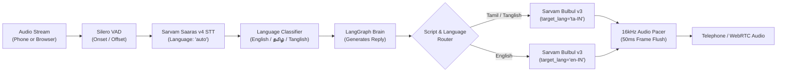

# 🎙️ Bilingual Voice Pipeline (STT & TTS)
> Related: [[Index]] • [[Architecture]] • [[Troubleshooting_Guide]]

This document details the audio engineering, models, and multilingual pipelines powering **Maya's** real-time voice processing.

---

## 1. Pipeline Overview



---

## 2. Speech-to-Text (ASR): Sarvam Saaras v4

- **Model Identifier**: `saaras:v4`
- **Primary Class**: `SarvamSTT` in [`agent/sarvam_stt.py`](file:///C:/Users/shahiil/Desktop/AI_hotel/agent/sarvam_stt.py)
- **Language Mode**: `auto` (automatically detects English, Tamil, or code-mixed input)

### Key Features
1. **Colloquial Tamil & Tanglish Support**:
   - Accurately transcribes phonetic Indian English, pure Tamil script, and mixed Romanized Tanglish:
     - *"Suite room book panna mudiyuma?"*
     - *"December 25th check-in irukka?"*
     - *"Family-oda 4 members varom."*
2. **Dual Transport Architecture**:
   - **LiveKit WebRTC Stream**: Ingests audio directly through LiveKit agents' native `ChunkedStream`.
   - **REST API Fallback**: Transcribes audio chunks via `https://api.sarvam.ai/speech-to-text` with automatic PyAV conversion to 16kHz mono WAV for browser-based audio uploads.

---

## 3. Text-to-Speech (TTS): Sarvam Bulbul v3

- **Model Identifier**: `bulbul:v3`
- **Voice Character**: `kavitha` (warm, professional, bilingual Indian receptionist)
- **Primary Class**: `SarvamTTS` in [`agent/sarvam_tts.py`](file:///C:/Users/shahiil/Desktop/AI_hotel/agent/sarvam_tts.py)

### Audio Engineering for Telephone PSTN (Critical Insight)

> [!important] The 16kHz vs 24kHz Telephony Rule
> - Standard WebRTC browsers support **24,000 Hz / 48,000 Hz** audio playback with full-spectrum laptop speakers.
> - **Cellular Telephony (PSTN / Twilio)** operates over **16,000 Hz (Wideband HD Voice / G.722 / Opus 16k)** or **8,000 Hz (Narrowband)**.
> - Generating 24kHz audio and forcing LiveKit's WebRTC engine to downsample to 8kHz/16kHz introduces aliasing, harmonic distortion, and a muffled/robotic sound.
> - **Solution**: Maya's telephony worker explicitly requests native **`speech_sample_rate = 16000`** from Sarvam. This produces warm, articulate, studio-grade speech directly over telephone speakers.

### Frame Pacing and Buffer Flush
When Sarvam returns the WAV buffer, the audio emitter must not push the entire multi-second payload in a single block. Instead, `SarvamChunkedStream` slices the PCM buffer into **50ms frames** and explicitly calls `output_emitter.flush()`:

```python
# Streaming in smooth 50ms frames to prevent packet drops over SIP
chunk_bytes = int(actual_rate * actual_channels * 2 * 0.05)
for i in range(0, len(pcm_data), chunk_bytes):
    output_emitter.push(pcm_data[i:i + chunk_bytes])
output_emitter.flush()
```

---

## 4. Multilingual Classifier (`agent/lang_detector.py`)

The language detection system operates in three tiers:

```mermaid
graph TD
    Input["User Input Text"] --> Check1{"Explicit Preference\nMentioned?"}
    Check1 -->|'tamil' / 'தமிழ்'| SetTa["Set Language: ta-IN"]
    Check1 -->|'tanglish'| SetTang["Set Language: tanglish"]
    Check1 -->|'english'| SetEn["Set Language: en-IN"]
    Check1 -->|No| Check2{"Contains Unicode\nTamil Script?"}
    Check2 -->|Yes (0B80 - 0BFF)| SetTa
    Check2 -->|No| Check3{"Matches Tanglish\nVocabulary?"}
    Check3 -->|'venum', 'irukka', 'aama'| SetTang
    Check3 -->|No| SetEn
```

### Supported Language Profiles

| Language Code | Display Label | TTS Voice Routing | Example Greeting / Response |
| :--- | :--- | :--- | :--- |
| `en-IN` | English (India) | `en-IN` (`kavitha`) | *"Welcome to Sunrise Hotel! How can I assist you with your booking today?"* |
| `ta-IN` | Tamil (தமிழ்) | `ta-IN` (`kavitha`) | *"வணக்கம்! சன்ரைஸ் ஹோட்டலுக்கு உங்களை வரவேற்கிறோம். எந்த வகை அறை வேண்டும்?"* |
| `tanglish` | Tanglish | `ta-IN` (`kavitha`) | *"Vanakkam! Deluxe room available-aa irukku, ungalukku check-in date solla mudiyuma?"* |

---

## 5. Pacing Calibration

| Channel | Configured Pace | Rationale |
| :--- | :--- | :--- |
| **Telephone Call (Twilio SIP)** | `1.00` | Ensures phone speakers with limited frequency response articulate consonants crisply. |
| **Web Browser (Local Audio)** | `1.15` | Slightly brisker, responsive conversational pace for desktop/headphone users. |
